<div align="center">

# 🛡️ ShieldIQ

**Cloud Security Posture Management (CSPM) for AWS misconfigurations and IAM risks, built with Python + Flask.**

Scan cloud and SaaS configurations, map every finding to compliance frameworks, trace the **attack paths** an attacker
could chain together, evaluate **effective IAM permissions**, and fix issues with **verified auto-remediation**.


</div>

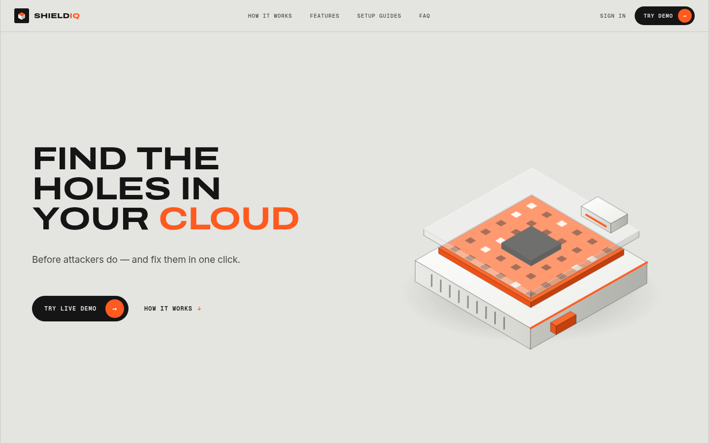

> **About this project.** ShieldIQ is a personal portfolio project by a B.Tech CSE (Cyber Security) graduate, built to
> learn and demonstrate cloud security engineering. It is not a commercial product and no company uses it. The demo
> workspace "Acme Labs" and all sample data (account IDs, users, keys) are **fictional**; any key-looking strings in
> the sample data and tests are fake, non-working values used to exercise the secret scanner.

## ✨ Highlights

- **65 security checks** across AWS (21), GCP (9), Azure (9), Kubernetes (9), GitHub (8), Slack (5) and source code (4),
  each with root cause, impact, step-by-step fix, CLI commands, Terraform/YAML and an auto-fixer.
- **IAM effective-permission analysis (v2.3):** a policy evaluator that combines explicit Deny, SCPs, resource
  policies, identity policies and permissions boundaries, and answers **Allowed / Denied / Indeterminate** with the
  exact policy statements as evidence. Detects privilege-escalation paths to admin (`AWS-IAM-007`).
- **Attack-path analysis:** a resource graph (internet → network → compute → identity → data) that finds paths to
  sensitive data and highlights the **choke point**, the single fix that breaks the most paths.
- **Verified auto-fix:** applies the fix to the stored configuration, re-scans, and only marks the finding resolved if
  the check now passes. Live cloud accounts are never modified.
- **Compliance mapping** to CIS, SOC 2, ISO 27001, PCI DSS, GDPR, NIST CSF 2.0 and HIPAA, with PDF reports.
- **Live read-only scanning** of AWS (boto3, `SecurityAudit`) and GitHub; IaC scanning of Terraform and Kubernetes YAML;
  a 14-detector secret scanner with entropy checks.
- **Security Copilot** that answers from your own findings (offline engine, optional OpenAI-compatible LLM).
- **Secure by design:** RBAC, multi-tenant orgs, CSRF, strict CSP, Fernet-encrypted integration secrets, login
  throttling, hashed API tokens, full audit log. Denied reads are reported as **Unknown**, never as "secure".

## 🔍 What it checks (AWS)

| Area | Examples |
|---|---|
| **IAM** | root MFA and root access keys, weak password policy, access keys older than 90 days, console users without MFA, admin or privilege-escalation permissions from **real policy documents** (`iam:PassRole` + `ec2:RunInstances`, `iam:CreatePolicyVersion`, `AttachUserPolicy`, …), effective-permission escalation paths to admin |
| **S3** | Block Public Access, public bucket ACLs/policies, default encryption, versioning |
| **EC2 / VPC** | security groups open to the internet on SSH/RDP/DB ports or all traffic, IMDSv1, unencrypted EBS volumes |
| **RDS** | publicly accessible instances, unencrypted storage, backup retention under 7 days |
| **Logging & monitoring** | CloudTrail in all regions, GuardDuty threat detection |
| **KMS** | customer-managed key rotation |

Plus GCP, Azure, Kubernetes, GitHub, Slack and source-code checks. The full list with fixes is on the in-app **Rules** page.

## 🏗️ Architecture

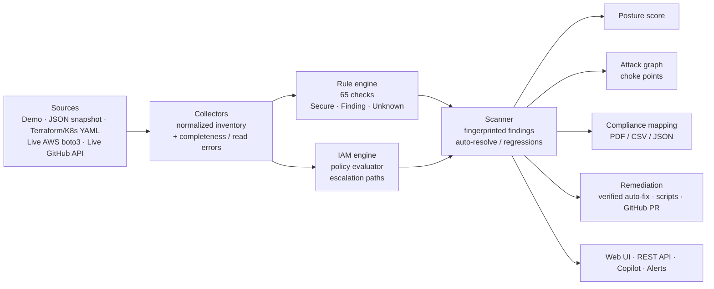

## 🧰 Tech stack

- **Backend:** Python 3.11, Flask 3, Flask-SQLAlchemy (SQLite by default, any SQLAlchemy URL), Flask-Login, Flask-WTF
- **Cloud:** boto3 (read-only AWS collector), GitHub REST API
- **Security:** cryptography (Fernet), CSRF, strict Content-Security-Policy, RBAC
- **Parsing & reports:** python-hcl2 (Terraform), PyYAML (Kubernetes), ReportLab (PDF)
- **Frontend:** server-rendered Jinja templates, hand-written CSS/JS and SVG (no framework, no CDN)
- **Testing:** pytest, botocore `Stubber`, an in-memory mock AWS for the validation kit

## 🔐 How scanning works

1. **Demo mode** (`SHIELDIQ_SEED_DEMO=1`): fictional sample environments so every feature works offline in two minutes.
2. **Snapshot import:** upload a JSON inventory (templates are downloadable per provider), e.g.
   `shieldiq/sample_data/aws_iam_lab.json` for the IAM lab.
3. **Live AWS (read-only):** `pip install -r requirements-cloud.txt`, create a dedicated IAM user with the AWS-managed
   **`SecurityAudit`** policy, and add an AWS integration in *Live* mode with its access key. Keys are encrypted at rest
   and are never committed; put local settings in `.env` (see [`.env.example`](.env.example)). ShieldIQ only reads:
   fixes for live accounts are delivered as scripts / Terraform / a GitHub PR for you to review.

### Sample findings (examples of what a scan reports)

| Severity | Rule | Finding |
|---|---|---|
| 🔴 Critical | `AWS-EC2-001` | Security group allows SSH/RDP or database ports from the internet |
| 🔴 Critical | `AWS-S3-002` | S3 bucket is publicly readable via ACL or bucket policy |
| 🔴 Critical | `AWS-RDS-001` | RDS database is publicly accessible |
| 🟠 High | `AWS-IAM-007` | IAM principal has an evidence-based privilege-escalation path to administrator |
| 🟠 High | `AWS-IAM-005` | IAM principal has full administrator privileges or can escalate to them |
| 🟠 High | `AWS-EC2-003` | EC2 instance allows IMDSv1 (metadata v2 not required) |
| 🟡 Medium | `AWS-IAM-004` | IAM access key older than 90 days |

In the demo workspace, the riskiest attack path, **PATH-001**, is: internet → open SSH security group → bastion → IAM role → customer-data bucket. Fixing the
choke-point security group breaks the path, and the re-scan proves it.

## Features

**Scanning**
- **65 security checks** across AWS (21), GCP (9), Azure (9), Kubernetes (9), GitHub (8), Slack (5) and source code (4).
  Every check has a root cause, impact, step-by-step fix, CLI commands and Terraform/YAML, and an auto-fix.
- **Four ways to connect a source:**
  - *Demo*: realistic sample environments, used for the out-of-the-box demo.
  - *Import JSON*: upload an inventory snapshot. A template is downloadable for each provider.
  - *Live GitHub*: real GitHub REST API scan of an owner or repo. It checks branch protection, a SECURITY.md policy and
    Dependabot config, and secret-scans up to 60 files. Works without a token for public repos.
  - *Live AWS*: read-only boto3 collector covering IAM, S3, EC2/SG/EBS, RDS, CloudTrail, KMS and GuardDuty.
    Optional; see below.
- **IaC scanner**: upload Terraform (`.tf`) or Kubernetes YAML and get findings before you deploy.
- **Secret scanner**: 14 detectors (AWS keys, GitHub/Slack/Stripe/Google tokens, private keys, DB URLs with passwords,
  JWTs and more) plus an entropy check. Matches are always masked.
- Re-scans are **idempotent**. Fixed issues auto-resolve, and regressions re-open with an alert.

**Analysis**
- **Posture score** (0–100, severity-weighted) with trend history.
- **Attack-path analysis**: builds a resource graph (internet → network → compute → identity → data) for each provider.
  It finds paths to sensitive data stores, scores each path's risk and highlights the **choke point**, the one fix that
  breaks the most paths.
- **Compliance mapping** for CIS, SOC 2, ISO 27001, PCI DSS, GDPR, NIST CSF 2.0 and HIPAA. Each control gets a pass
  rate, the framework score is the average across controls, and a provider × framework heatmap shows where the gaps are.
- **Security Copilot**: chat that answers from *your* data, e.g. "what should I fix first?", "explain finding #12",
  "show attack paths" or "how do we look for PCI?". It works offline with a built-in engine. If you add an
  OpenAI-compatible API key it uses the LLM, grounded in your findings, and falls back automatically on any error.

**Remediation**
- **Verified auto-fix** for demo/imported sources. It applies the fix to the stored configuration, re-scans, and marks
  the finding resolved only if the check now passes. Every step is logged. It never touches live cloud accounts.
- **Fix scripts**: download per-finding shell (CLI) or Terraform/YAML. On Windows, run the shell scripts in Git Bash or WSL.
- **GitHub pull request**: commits the fix file to a new branch in your remediation repo and opens a real PR.
  Needs a repo + token in Settings.
- Triage workflow: open → in progress → accepted risk / false positive / resolved, with notes and bulk actions.

**Platform**
- Multi-tenant organizations, with **RBAC** (admin / analyst / viewer).
- Login lockout after repeated failures, per-network login and registration throttling, and a password policy.
- CSRF on all forms, a strict Content-Security-Policy (no inline scripts) and security headers.
- Integration secrets are **encrypted at rest** (Fernet).
- **Reports**: PDF executive/framework reports, plus CSV (formula-injection safe) and JSON exports.
- **Alerts**: in-app alerts, with optional Slack webhook and SMTP email delivery.
- **Audit log** of every security-relevant action.
- **REST API** (`/api/v1`) with hashed API tokens. Interactive docs are on the API page.
- **Design**: an industrial-blueprint, minimal look inspired by a Dribbble reference (warm grey, charcoal, one signal
  orange that only means critical or fix, extra-wide uppercase type, mono labels, isometric 3D objects), a public
  landing page with a 3D module hero and a pinned five-step scroll story acted out on the demo's real attack path,
  light and dark themes (remembered per user), a score dial, odometer counts, isometric attack-path drawings, a
  single-hue compliance matrix, error pages and a command palette (Ctrl + K). Responsive down to phone width.
- No front-end framework, no animation or chart library, no CDN: nothing is loaded from the internet at runtime. All
  motion is time-based (same speed at any refresh rate) and respects the operating system's "reduce motion" setting.

## Quick start

You need **Python 3.10 or newer** ([python.org](https://www.python.org/downloads/)).

### Windows (PowerShell)

```powershell
git clone https://github.com/Praneethrayalu/ShieldIQ-CSPM.git
cd ShieldIQ-CSPM
py -m venv .venv
.venv\Scripts\Activate.ps1      # if blocked: Set-ExecutionPolicy -Scope CurrentUser RemoteSigned
pip install -r requirements.txt
python run.py
```

On Command Prompt (cmd) instead of PowerShell, activate with `.venv\Scripts\activate.bat`.

No PowerShell at all? Double-click **`test-windows.bat`**: it checks Python, builds the virtual environment,
installs dependencies, runs the full test suite and starts the app, writing everything to `windows-test-log.txt`.
It needs no admin rights and changes no system settings.

### Linux / macOS

```bash
git clone https://github.com/Praneethrayalu/ShieldIQ-CSPM.git
cd ShieldIQ-CSPM
python3 -m venv .venv
source .venv/bin/activate
pip install -r requirements.txt
python run.py
```

Open **http://127.0.0.1:5000**. Visitors see the landing page.

**Demo mode is off by default (v2.2).** To get the fictional sample workspace and the demo logins below, start with
`SHIELDIQ_SEED_DEMO=1` (in `.env` or the environment) - local / portfolio use only, never on an internet-facing
deployment. In demo mode **Try live demo** signs you straight into the sample workspace, or sign in with any demo
account:

| Role | Email | Password |
|---|---|---|
| Admin | `demo@shieldiq.local` | `ShieldIQ@2026` |
| Analyst | `analyst@shieldiq.local` | `ShieldIQ@2026` |
| Viewer (read-only) | `viewer@shieldiq.local` | `ShieldIQ@2026` |

On the first run ShieldIQ creates `instance/` with a SQLite database and its own secret and encryption keys (and,
in demo mode, scans the sample environments). To start fresh, stop the app and delete the `instance/` folder.
You can also **register** your own organization, which starts empty.

### A two-minute tour
0. **Landing page** (`/`, or `/welcome` while signed in): press **Apply the fix** on Fig. 1, then **Try live demo**.
1. **Dashboard**: posture score with its change since the last scan, trend, the findings to fix first, compliance.
2. **Attack paths**: open PATH-001 (internet → open SSH security group → bastion → IAM role → customer-data bucket).
3. Click the choke-point finding, then **Auto-fix & verify**. The score goes up and the path disappears.
4. **Copilot**: ask "What should I fix first?"
5. **Scanners**: download the sample `main.tf` (or upload your own Terraform/YAML) and scan it; paste code into the secret scanner.
6. **Reports**: generate a SOC 2 PDF.

## IAM effective permissions (v2.3)

ShieldIQ now evaluates **who can actually do what** in an AWS account instead of trusting policy names. Full details:
[`docs/IAM_ANALYSIS.md`](docs/IAM_ANALYSIS.md).

- **Engine** (`shieldiq/iam/`): explicit Deny → SCPs → resource policies → identity policies (direct, group-inherited,
  role) + permissions boundaries; `Action`/`NotAction`, `Resource`/`NotResource`, wildcards, policy variables and
  conditions. Results are **Allowed**, **Denied** or **Indeterminate** with the exact policy statements as evidence and
  the missing data listed. Unreadable documents, unknown boundaries, unreadable SCPs or missing request context give
  Indeterminate — never "safe". It does **not** claim full AWS authorization equivalence (session policies,
  cross-account, RCPs, most resource-policy types are not modelled — see the doc).
- **Collection**: `iam:GetAccountAuthorizationDetails` (paginated) for boundaries, trust policies, groups and policy
  versions; AWS Organizations SCPs when readable; S3 bucket policies. A per-source **completeness indicator** with
  structured errors (API, resource, code, denied/throttled/not_found/error).
- **Scan states**: every check result is **Secure**, **Finding** or **Unknown / Incomplete**. Unknown is counted
  separately, is not part of the score and never auto-resolves a finding.
- **Attack paths** (`AWS-IAM-007`, IAM page, Attack paths page): assume-role, trust-policy rewrite, attach/put/
  create-version of policies, PassRole to a service, credential takeover — each step with its policy evidence,
  confidence (confirmed / likely / unverified) and what is missing.
- **Safe remediation**: dry-run preview with plain-language risk, offending statement, least-privilege proposal,
  before/after diff, impact, validation, explicit typed approval, apply to stored (demo/snapshot) inventories only,
  re-scan verification. **Live AWS is never changed** — you get the proposed policy and CLI steps, then *verify by
  re-scan*.
- **Copilot** answers IAM questions with *verified facts*, *assumptions* and *missing data* kept apart.
- **Validation kit** (`validation/`): setup / run / report / cleanup for a dedicated AWS test account, comparing
  ShieldIQ with `iam:SimulatePrincipalPolicy`. So far run against an in-memory mock (23/23) —
  **live AWS validation not executed**.

Try it without AWS: *Integrations → Add → Import JSON* with `shieldiq/sample_data/aws_iam_lab.json` (synthetic lab),
scan it, then open **IAM analysis**.

Permissions for live scanning: `SecurityAudit` (+ `validation/policies/shieldiq-scanner-extra-policy.json` for the
simulator). SCPs are readable only from the management/delegated-admin account; elsewhere they show as *unavailable*.

Tests: `pytest -q` (mocked; the live test in `tests/integration/` is skipped unless
`SHIELDIQ_LIVE_AWS_VALIDATION=1`, `SHIELDIQ_VALIDATION_ACCOUNT` and `AWS_PROFILE` are set).

## Optional configuration

Copy `.env.example` to `.env`. Every setting is optional:

| Setting | What it enables |
|---|---|
| `SHIELDIQ_LLM_API_KEY` (+ `_BASE_URL`, `_MODEL`) | LLM answers in the Copilot (any OpenAI-compatible API) |
| `GITHUB_TOKEN` | Higher GitHub rate limits; default token for fix PRs |
| `SHIELDIQ_SLACK_WEBHOOK_URL`, `SHIELDIQ_SMTP_*` | Alert delivery to Slack / email |
| `DATABASE_URL` | Use Postgres/MySQL instead of SQLite (install its driver, e.g. `psycopg2-binary`) |
| `SHIELDIQ_SEED_DEMO=1` | Demo mode: create the demo organization and show the demo logins (off by default) |
| `SHIELDIQ_ALLOWED_AWS_PROFILES=a,b` | AWS CLI profiles live integrations may pick (empty/unset = profiles disabled) |

**Live AWS scanning** needs boto3: `pip install -r requirements-cloud.txt`. Then add an AWS integration in *Live* mode
with a read-only IAM user (the AWS-managed `SecurityAudit` policy is enough). AWS CLI profiles on the server can only
be used if the operator lists them in `SHIELDIQ_ALLOWED_AWS_PROFILES` (so tenants can never borrow the server's own
credentials). Every enabled region is scanned by default; a comma-separated region list can be set per integration.
See `CHANGELOG.md` for what v2.2.0 changed in detection.

## Tests

```bash
python -m pytest -q
```

**253 tests pass** (1 live-AWS test is opt-in and skipped by default). They cover:
- every rule and every auto-fixer (each fixer must make its own check pass);
- the Terraform/Kubernetes parsers and the secret detectors;
- scan sync (idempotency, auto-resolve, regression);
- attack paths and choke-point fixes;
- auth, lockout, open-redirect protection, RBAC, tenant isolation, CSRF and the API;
- the setup guides page (all six providers);
- the landing page (public route, demo sign-in, CSP-safe scripts, every referenced asset exists) and the theme toggle;
- PDF/CSV/JSON reports;
- the GitHub PR flow, the GitHub and AWS collectors, LLM fallback and Slack delivery;
- the v2.2 detection fixes (real IAM policy documents, denied reads as Unknown) and the v2.3 IAM evaluator, attack paths, remediation previews and validation kit.

The network is mocked, so the tests run offline.

## REST API

Create a token in **Settings → API tokens**, then:

```bash
curl -H "Authorization: Bearer siq_..." http://127.0.0.1:5000/api/v1/summary
curl -H "Authorization: Bearer siq_..." -H "Content-Type: application/json" \
     -d '{"filename": "main.tf", "content": "resource \"aws_db_instance\" \"d\" { publicly_accessible = true }"}' \
     http://127.0.0.1:5000/api/v1/scan/iac
```

The `scan/iac` endpoint returns `"passed": false` plus findings, so it can gate a CI pipeline. All endpoints are listed
on the in-app **API** page.

Endpoints:
- `summary`
- `findings`, `findings/<id>` (GET/PATCH), `findings/<id>/autofix`
- `integrations`, `integrations/<id>/scan`
- `scan/iac`, `scan/secrets`
- `compliance`, `attack-paths`, `rules`
- `copilot/chat`, `search`

CLI commands:
- `flask --app run seed-demo`
- `flask --app run scan-all` (for cron / Task Scheduler)
- `flask --app run reset-db`

## Project structure

```
run.py                     entry point
shieldiq/
  __init__.py              app factory, security headers, error pages
  config.py                settings (.env), auto-generated secrets
  models.py                SQLAlchemy models (orgs, users, integrations, findings, scans, alerts, audit, reports)
  auth.py  views.py  api.py  web routes and REST API
  rules/                   65 checks + auto-fixers per provider, secret detectors (code.py), rule engine
  collectors/              demo data, JSON snapshot validation, Terraform/K8s parsers, live GitHub + AWS
  services/                scanner, compliance, attack graph, copilot, remediation, reports, alerts, audit
  templates/  static/      UI (no CDN: Archivo, Inter and Geist Mono are bundled; charts and 3D are server-rendered SVG)
    templates/landing.html   public landing page; static/js/landing.js draws its motion graphic
    static/css/app.css       the design system (tokens for dark + light, components, motion)
  sample_data/             fictional demo environments + sample Terraform / Kubernetes files
tests/                     pytest suite
```

## How it works (short version)

1. A **collector** turns a source (demo data, JSON, Terraform, YAML, GitHub API, AWS API) into a normalized inventory.
2. The **rule engine** runs every check for that provider and returns pass/fail for each resource.
3. The **scanner** syncs results into findings by fingerprint (provider + rule + resource). New findings raise alerts,
   passing ones auto-resolve, and the posture score is recomputed.
4. **Compliance** maps each rule to framework controls. The **attack graph** links resources (security group →
   instance → role → bucket) and searches for paths from the internet to sensitive data.
5. **Auto-fix** applies the rule's fixer to the stored inventory, re-runs the check and only then resolves the finding.

## Limitations (honest notes)
- Live scanning is implemented for **GitHub and AWS only**. GCP, Azure, Kubernetes and Slack use demo data, JSON
  snapshot import, or (Kubernetes) YAML upload.
- Auto-fix changes ShieldIQ's stored copy of a configuration and proves the fix by re-scanning. It deliberately does
  **not** modify real cloud accounts. For real systems use the generated scripts or the GitHub PR.
- The built-in Flask server is for local use. For a real deployment, use a WSGI server (e.g. gunicorn/waitress) behind
  HTTPS with `SHIELDIQ_SECURE_COOKIES=1`.
- Compliance mapping is simplified and educational. It is not an audit tool.
- Demo sign-in (only in demo mode, `SHIELDIQ_SEED_DEMO=1`) uses public credentials. If a database was ever seeded
  in demo mode, delete or re-password the three demo accounts before exposing it.
  Per-network throttles can be tuned with `SHIELDIQ_LOGIN_IP_MAX_ATTEMPTS` and `SHIELDIQ_REGISTER_IP_MAX_ATTEMPTS`.
- If ShieldIQ runs behind a reverse proxy, set `SHIELDIQ_TRUST_PROXY=1` so the audit log records the real client IP
  from `X-Forwarded-For`. By default the header is ignored (it is trivial to spoof).

### Upgrading from v2.1.0
This version adds a uniqueness rule on stored findings (one per source + fingerprint), which `create_all` cannot
retrofit onto an existing database. Two safe options:

1. **Keep your data** (local SQLite): run `flask --app run migrate-db` from the new folder. It copies your database
   to a timestamped `.bak` file first, then rebuilds the changed tables to match the current models, collapsing any
   duplicate findings to their oldest copy, and runs an integrity check. Restore the `.bak` if anything looks
   wrong. (Postgres/MySQL: back up and apply the change with your usual tooling instead.)
2. **Start clean**: extract this version to a new, separate folder and run it there; it creates its own fresh
   database on first start. Keep the old v2.1.0 folder untouched either way until you are sure.

### Hardening from the Oct 2026 deep review
An external line-by-line review (104 tests now, including 23 new regression tests) led to these fixes and
improvements:
- per-network login and registration throttling, on top of per-account lockout;
- a backup-first database migration command (`migrate-db`) so existing data survives schema upgrades. It uses
  SQLite's online backup API, refuses schemas it does not recognise (pointing you at a fresh folder instead),
  re-points alerts/remediations when duplicate findings collapse, and verifies integrity before committing;
- concurrent-scan safety enforced by the database itself (a unique partial index allows at most one running
  scan per source; the app check is just the friendly face of it), and interrupted runs are closed cleanly;
- form `next` redirects are validated as local paths (previously any URL was echoed back);
- findings are unique per integration + fingerprint, and a concurrent duplicate scan now fails cleanly instead of
  inserting duplicates;
- API tokens persist `last_used_at` on every authenticated call;
- the audit log only trusts `X-Forwarded-For` when `SHIELDIQ_TRUST_PROXY=1` is set;
- the Copilot API caps message length server-side (4000 chars);
- over-long emails (>255 chars) are now rejected on both the register and admin "add user" forms, instead of
  being silently truncated (which could have collapsed two different addresses onto one account);
- PDF reports now use the same charcoal + signal-orange palette as the web UI.

### Live-scan coverage reporting (v2.1.3)
A live scan with a least-privilege auditor key (e.g. the AWS managed `SecurityAudit` policy) can be denied some
reads. Previously those failures were either swallowed silently or, worse, replaced with defaults - which could
turn "ShieldIQ could not read this" into a passing check, a failing check, or an apparently empty account.
This version fixes that class of defect:

- every failed read is recorded in a sanitized, structured form (the call, the AWS error code, the HTTP status
  and a coarse kind: denied / not-found / error). Error *message text* is never stored, because AWS error
  messages can embed account ARNs, resource names and request parameters;
- the affected inventory fields stay unknown instead of being defaulted, and the rules skip unknown data - a
  denied read is never reported as a pass, a fail, or a genuinely empty account;
- genuine "not configured" answers (NoSuchEntity and friends) are still real findings: an account with no
  password policy, no CloudTrail or no bucket encryption is reported exactly as before;
- a scan that evaluated fewer checks than it attempted finishes with status **partial** (not "completed"), with
  a coverage note on the source card, in the scan flash, in the API response and in the audit log. Sources that
  return nothing readable say so ("No checks were evaluated") instead of looking like a clean 100%;
- posture scores cover evaluated checks only, and the scan result states that when coverage was partial.

Regression tests cover the swallowed-error path end to end: denied vs. empty vs. unset reads, per-bucket
partial data, unknown CloudTrail logging state, and the scan-run status plumbing (112 tests in total).

## What changed from v1
v1 (FastAPI + Node + React) could not start, because its hard-coded fallback encryption key was not a valid Fernet key.
Its copilot, attack graph and auto-fix also returned fixed demo responses. This version is a clean rewrite in Flask:
- every feature is computed from real scan data;
- auto-fix is verified by a re-scan;
- live GitHub and AWS collectors were added;
- there is a full test suite;
- it runs offline with one `pip install`.

## Design & UI

**Industrial blueprint, minimal.** The visual direction is inspired by a Dribbble reference (an AI-finance landing
page by a design studio): a light warm-grey canvas, charcoal ink and charcoal sections, **one signal orange** that only
means *critical* or *the fix*, an extra-wide uppercase grotesk for headlines (Archivo at width 125, vendored),
small mono labels, a few 1px blueprint hairlines, and isometric 3D objects. Lots of empty space: one idea per section.

- **The 3D ShieldIQ module** (hero, sign-in): an isometric security appliance drawn in SVG (chassis, orange core
  board with LEDs, glass cover, cap). It assembles on load and its layers pull apart as you scroll (exploded view).
- **The scroll story** (`/#how`): a pinned section shows one step at a time (Connect → Scan → Prioritise → Fix →
  Prove) beside an isometric model of the demo's real riskiest attack path (internet → firewall rule → server →
  access role → customer data). Blocks assemble, a scan sweeps and risky blocks turn orange, the path traces across
  them, the fix cuts it and they turn safe, and the score rolls up — all with the demo's real numbers.
- **Inside the app:** a hairline sidebar with mono labels, white cells without outlines, huge numerals, and the same
  isometric attack-path drawing on the dashboard and the attack-paths page. Light and charcoal dark themes; mobile
  responsive.

All motion is hand-written (`shieldiq/static/js/motion.js` + `landing.js`, no libraries, no CDN), time-based so it runs
at the same speed on 60/120/144 Hz screens, animates transform/opacity (plus one-shot SVG line draws), and respects
`prefers-reduced-motion`. Every animation and the reason it exists is listed in [docs/DESIGN.md](docs/DESIGN.md).


| Scroll story (one step at a time) | Three key features |
|---|---|
| 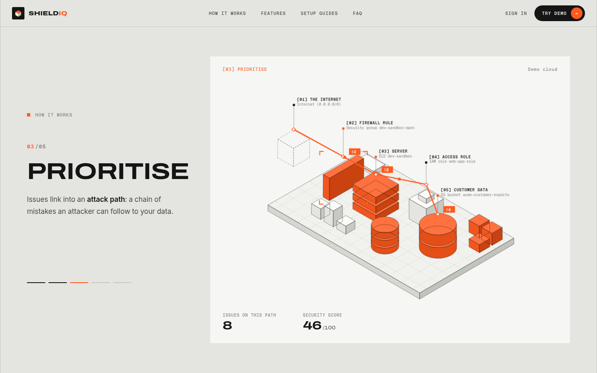 | 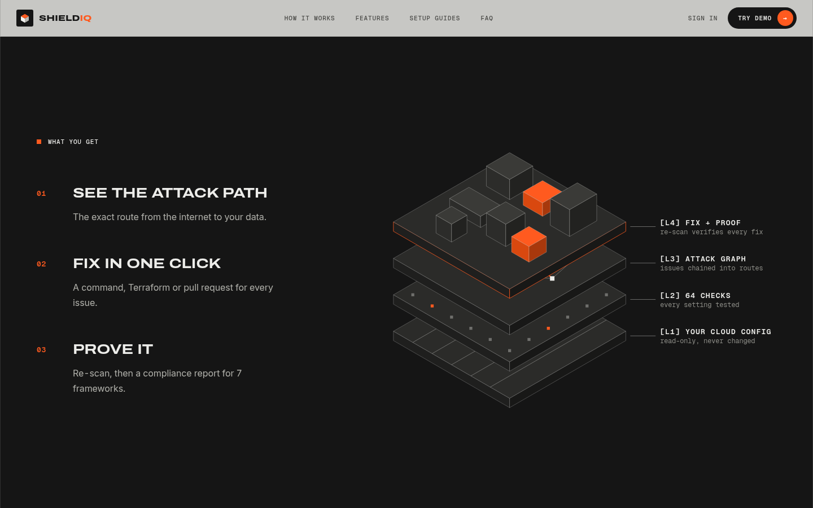 |
| **Dashboard (light)** | **Dashboard (dark)** |
| 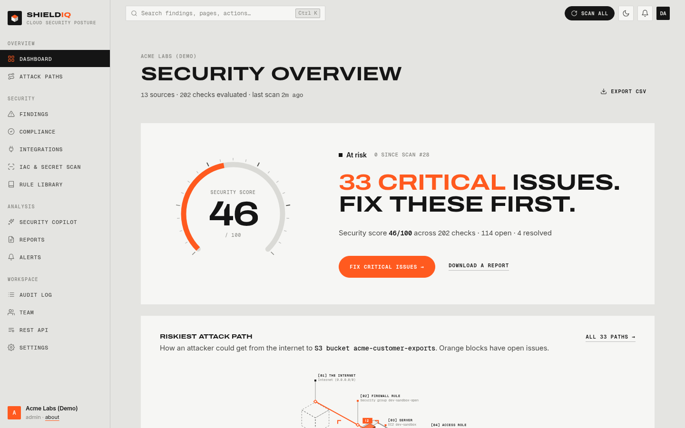 | 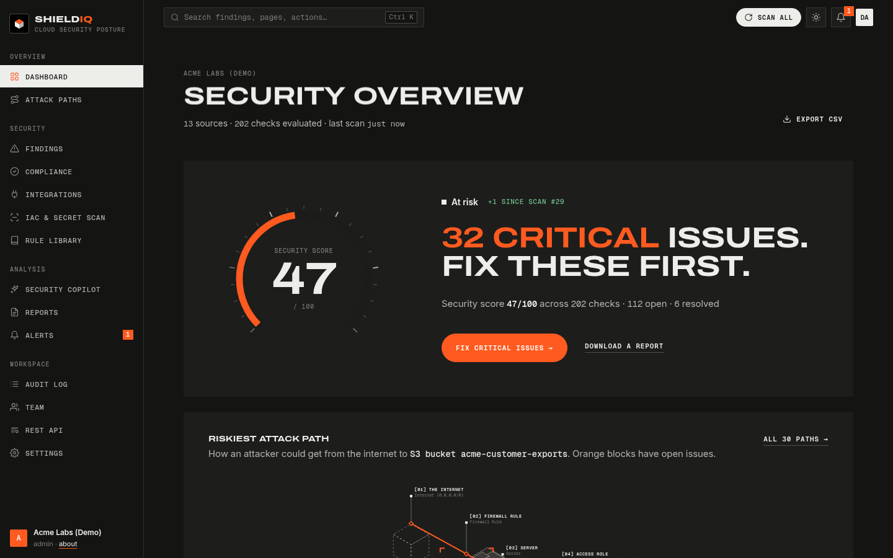 |
| **Attack paths** | **Finding, fixed and verified** |
| 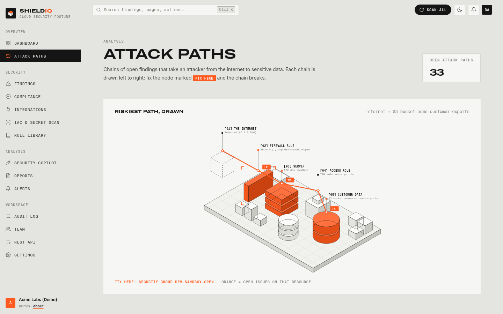 | 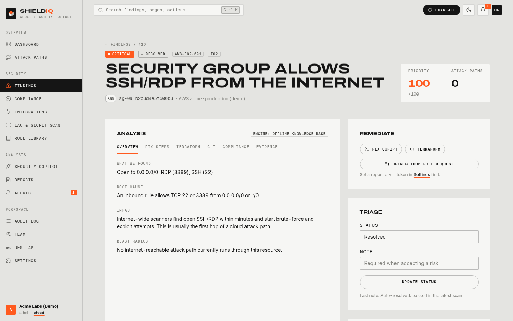 |
| **Security Copilot (dark)** | **Compliance** |
| 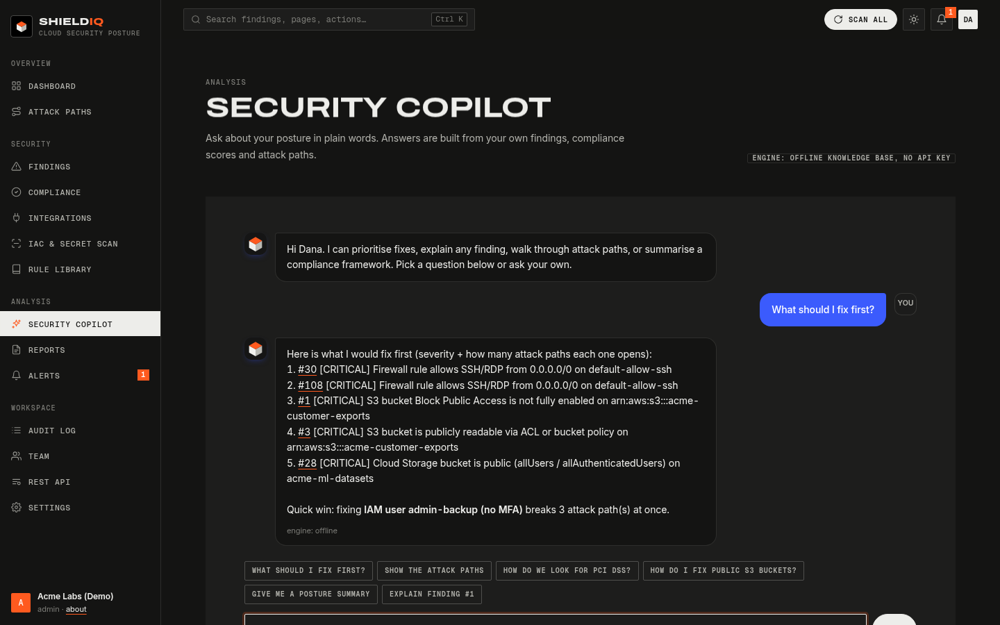 | 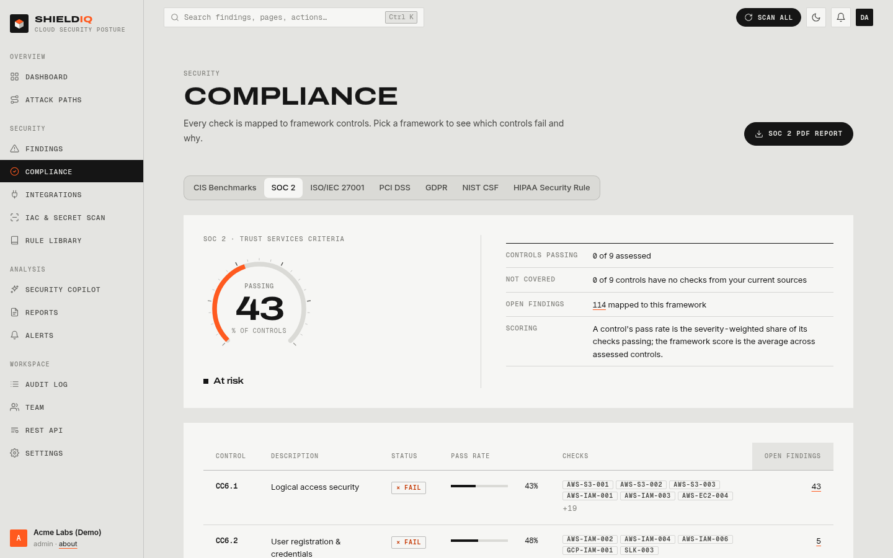 |
| **Sign in** | **Error page** |
| 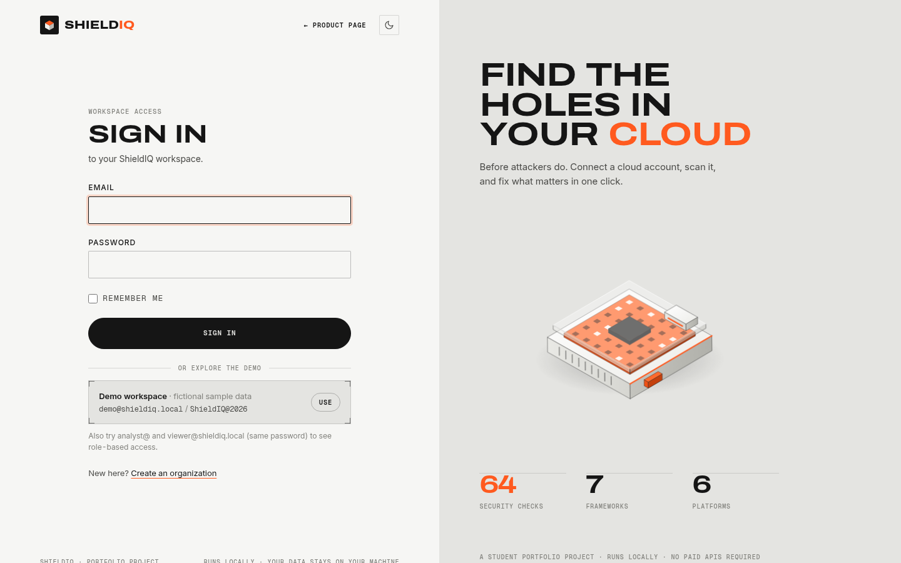 | 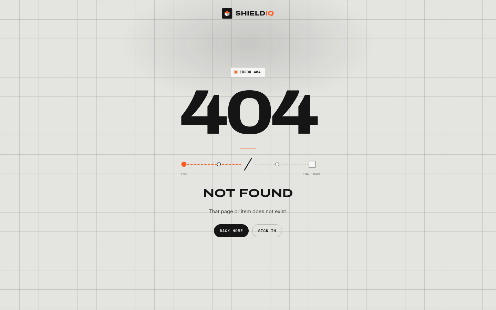 |

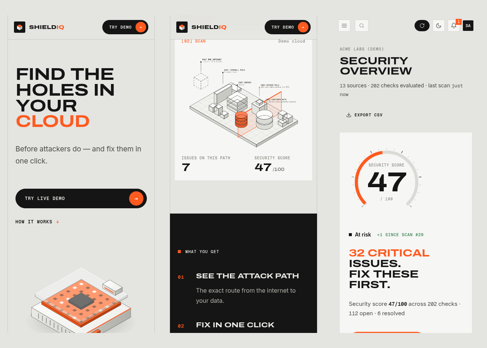

**Setup guides** (`/guides`): step-by-step for AWS, GitHub, Google Cloud, Azure, Kubernetes and Slack, covering
what to click in that platform, what to paste into ShieldIQ, then scanning, fixing, attack paths and compliance PDFs.
The guides are honest about what's live (AWS, GitHub) and what's a snapshot import. The FAQ lives there too.

| Setup guide (AWS) | After you connect |
|---|---|
| 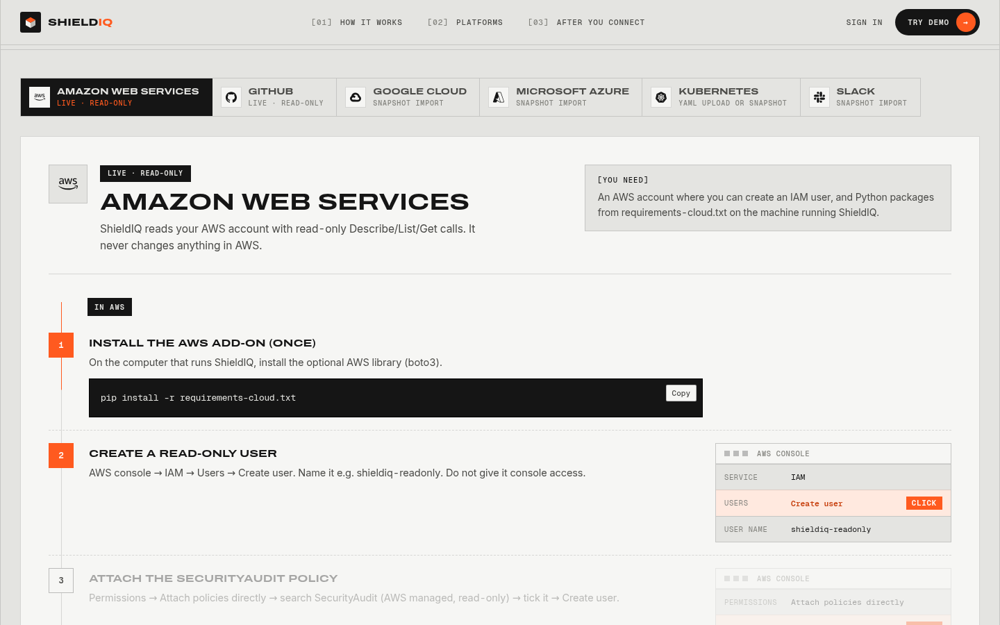 | 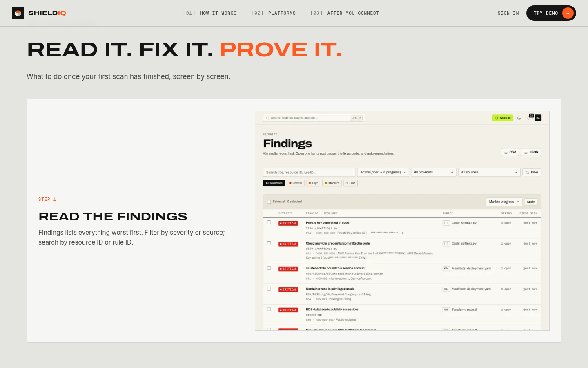 |


## 📚 Documentation

- [`docs/IAM_ANALYSIS.md`](docs/IAM_ANALYSIS.md): how the IAM effective-permission engine works, and its limits
- [`docs/ShieldIQ_v2.3_IAM_Guide.pdf`](docs/ShieldIQ_v2.3_IAM_Guide.pdf): illustrated guide to the v2.3 IAM features
- [`docs/DESIGN.md`](docs/DESIGN.md): the design system and every animation
- [`validation/README.md`](validation/README.md): the live-AWS validation kit
- [`CHANGELOG.md`](CHANGELOG.md): release notes for v2.2.0 and v2.3.0

## 🗺️ Roadmap

- Live collectors for GCP and Azure (currently demo / snapshot import)
- More resource-policy types in the IAM engine (KMS, SQS, SNS, Lambda) and session policies
- Live AWS validation run against a dedicated test account (the validation kit is ready in `validation/`)
- Scheduled scans with drift notifications, and a Docker image / GitHub Actions workflow for CI gating via `/api/v1/scan/iac`
- Exportable SARIF for GitHub code scanning

## 👤 Author

**Praneeth Rayalu Repalle** — B.Tech CSE (Cyber Security), Lovely Professional University

- GitHub: [@Praneethrayalu](https://github.com/Praneethrayalu)
- LinkedIn: [linkedin.com/in/praneeth-rayalu](https://www.linkedin.com/in/praneeth-rayalu)
- Portfolio: [praneeth.rpr.dpdns.org](https://praneeth.rpr.dpdns.org/)

## 📄 License

Released under the [MIT License](LICENSE).
