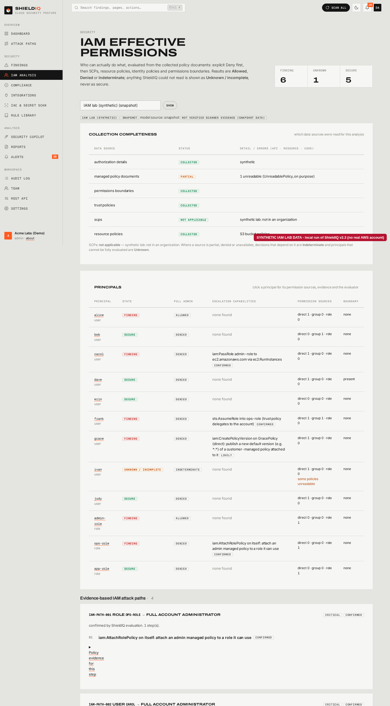
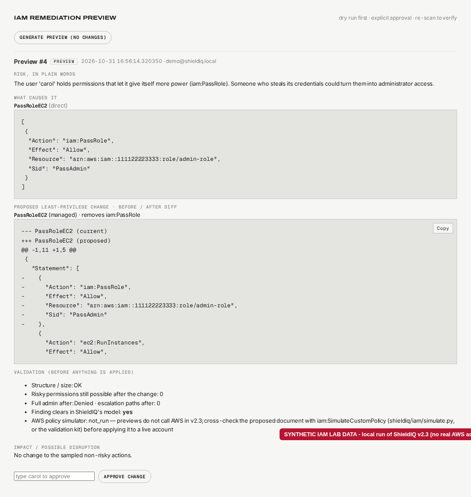

# ShieldIQ v2.3 — IAM effective-permission analysis

This document covers the v2.3 IAM security enhancement: what is collected, how permissions are evaluated, how attack
paths and remediation previews are built, what AWS permissions are needed, how to test and validate it, and — most
importantly — what it does **not** do.

> **Status of validation.** Everything in v2.3 is tested with synthetic data only (botocore `Stubber`, fake sessions,
> the synthetic IAM lab in `shieldiq/sample_data/aws_iam_lab.json`, and an in-memory mock AWS for the validation kit).
> **Live AWS validation has NOT been executed** — it needs a dedicated, isolated AWS test account (see
> [Validating against a real AWS test account](#5-validating-against-a-real-aws-test-account)).

## 1. Architecture

v2.3 extends the existing pipeline (collect → evaluate rules → sync findings → score); it does not replace it.

```
collectors/aws_live.py ──► collectors/aws_iam.py ──► inv["iam"] / inv["iam_context"] + inv["_sources"]
                                                       │
                     shieldiq/iam/model.py  ◄──────────┘   (also converts v2.2 / demo / snapshot inventories)
                              │ AuthzModel: principals, groups, policies, boundaries, trust, SCPs, resource policies
                     shieldiq/iam/policy.py     Action/NotAction, Resource/NotResource, variables, conditions (3-valued)
                     shieldiq/iam/evaluator.py  Allowed / Denied / Indeterminate + exact statement evidence
                     shieldiq/iam/analysis.py   admin probe, escalation capabilities, evidence-based attack paths
                     shieldiq/iam/remediation.py preview, diff, validation, impact, apply-to-stored-inventory
                     shieldiq/iam/simulate.py   optional iam:SimulatePrincipalPolicy / SimulateCustomPolicy cross-check
                              │
rules/aws.py  AWS-IAM-005 (admin/escalation, now boundary/SCP/deny aware) + AWS-IAM-007 (escalation paths)
rules/engine.py  CheckResult.passed = True / False / None  → Secure / Finding / Unknown
services/scanner.py  Unknown counted separately, never resolves a finding
services/iam_service.py  UI/API/Copilot facade + remediation workflow (Remediation rows, mode "iam_preview")
views.py /iam, /iam/<id>/principal/<kind>/<name>, finding remediation steps; api.py /api/v1/iam/*; copilot.py
```

No database schema change: the authorization model is stored in the integration's existing `snapshot` JSON, and
remediation previews use the existing `remediation` table (`mode = "iam_preview"`, `steps` holds the preview).

## 2. What is collected (read-only)

| Data | API | If it fails |
|---|---|---|
| Users, groups, roles, membership, attached + inline policies, boundaries, trust policies, tags, customer-managed policy versions | `iam:GetAccountAuthorizationDetails` (paginated, all pages) | falls back to the v2.2 per-call reads + `iam:GetUser`/`iam:GetRole` for boundaries; unreadable boundary = **unknown** |
| AWS-managed policy documents that are attached | `iam:GetPolicy` + `iam:GetPolicyVersion` | document unknown → decisions **Indeterminate** |
| Service control policies | `organizations:DescribeOrganization`, `ListRoots`, `ListParents`, `ListPoliciesForTarget`, `DescribePolicy` | `not_applicable` (not in an org), `management_account` (SCPs don't apply), `disabled`, or **`unavailable`** → every Allowed that depends on SCPs becomes Indeterminate |
| Resource-based policies | `s3:GetBucketPolicy` (+ role trust policies) | `unknown` → Indeterminate for that resource |
| Everything v2.2 already read | unchanged | unchanged (`_errors`, partial scans) |

Every failure is a structured record `{api, resource, code, status, kind}` with `kind` ∈ denied / throttled / not_found /
error. AWS error *messages* are never stored (they can contain ARNs). Real boto3 sessions use botocore's adaptive retry
mode for throttling; a throttle that persists is recorded as `throttled` and the data is unknown.

**Scan completeness indicator.** `inv["_sources"]` has one row per data source (status: collected / partial / denied /
unavailable / not_applicable / not_collected) with its errors. The IAM page shows it as a table. The v2.2 rule — a
failed core read makes the scan *partial* and never resolves findings — is unchanged; IAM-enrichment gaps are tracked
per source and turn the affected decisions Indeterminate instead.

## 3. Evaluation semantics

Implemented for a request by an IAM user or role **in its own account** (AWS "policy evaluation logic"):

1. **Explicit Deny** in any applicable policy (identity, boundary, SCP, resource policy) → **Denied**.
2. **SCPs**: every level (root, each OU, the account) must Allow. Not applied to the management account or to
   service-linked roles.
3. **Resource-based policy** naming the principal can grant on its own (same account). For an IAM user that grant is
   not limited by the user's boundary; for a role ARN it is.
4. Otherwise an **identity-based Allow** (direct, group-inherited or role policy) **and** the **permissions boundary**
   (if set) must both Allow.

Policy language: `Action`/`NotAction` (case-insensitive wildcards), `Resource`/`NotResource` (ARN wildcards),
policy variables (`${aws:username}`, `${aws:PrincipalTag/...}`, `${*}`…), conditions with AND/OR semantics,
`...IfExists`, `ForAnyValue:`/`ForAllValues:`, `Null`, and the String / Numeric / Date / Bool / IpAddress / Arn
operator families.

**Three results, never two.** Every input is three-valued (yes / no / unknown). The result is **Indeterminate**
whenever the answer depends on something unknown: an unreadable policy document, an unknown boundary, SCPs that could
not be read, a policy variable without a value, a condition key not in the request context, an unsupported operator,
or `NotPrincipal`. Indeterminate is never displayed or counted as safe. Unknown restriction layers (boundary, SCP) can
never turn a Denied into Allowed, so a Denied stays Denied.

**Request context.** By default the context is *incomplete* (a scan does not know the caller's IP, MFA state, tags,
time), so conditional grants come out Indeterminate. On the principal page (and in the API) you can supply context
keys and mark them as the *complete* context; AWS's missing-key rules then apply (missing key → condition false,
except negated operators / `IfExists` / `ForAllValues`, which are true).

**Policy names are not evidence.** A policy known only by its name (demo data, old snapshots) has no document: its
effect is unknown. `AWS-IAM-005` still reports a principal with a policy *named* `AdministratorAccess`, labelled
`basis: policy name only (unverified)`, `confidence: low`; a list of names can no longer make a principal "scoped"
(it is Unknown). The only built-in documents are three AWS-managed policies (AdministratorAccess, IAMFullAccess,
PowerUserAccess) when referenced by their `arn:aws:iam::aws:policy/...` ARN; the evidence says `builtin-aws-managed`.

### 3.1 Not modelled (unsupported semantics)

ShieldIQ does **not** claim AWS authorization equivalence. Not modelled:

- session policies, role-session tags, `sts:SourceIdentity`, federated / SAML / OIDC sessions;
- cross-account access (both the identity side and the resource side must allow — only same-account is evaluated);
- resource control policies (RCPs), VPC endpoint policies, permission sets / Identity Center;
- resource policies other than S3 bucket policies and role trust policies (KMS key policies & grants, SQS, SNS,
  Lambda, Secrets Manager, ECR … are not collected);
- S3 ACLs / Object Ownership interplay in the permission engine (ACLs are still checked by the S3 rules);
- service-specific authorization rules and implicit request properties (e.g. `aws:SecureTransport`) unless supplied
  in the context;
- `NotPrincipal` (→ Indeterminate), policy-size/syntax validation beyond basic structure.

"Allowed" therefore means *allowed by every layer ShieldIQ collected and evaluated*. Use the AWS policy simulator
cross-check for authoritative confirmation.

## 4. Evidence-based attack paths (AWS-IAM-007)

Every edge is an evaluator decision for a concrete action on a concrete resource from the inventory, with the exact
statements behind it (policy, via direct/group/role, Sid, statement index, the statement JSON):

| Edge | Requires |
|---|---|
| assume_role | `sts:AssumeRole` on role R evaluated with R's trust policy as the resource policy (trust naming the principal grants on its own; trust delegating to the account needs the identity Allow) |
| update_trust | `iam:UpdateAssumeRolePolicy` on R |
| pass_role | `iam:PassRole` on R **and** a service create action (ec2:RunInstances, lambda:CreateFunction, cloudformation:CreateStack, glue:CreateDevEndpoint, datapipeline:CreatePipeline, ecs:RunTask, sagemaker:CreateNotebookInstance) **and** R trusts that service |
| credentials | `iam:CreateAccessKey` / `CreateLoginProfile` / `UpdateLoginProfile` on another user |
| self_escalation | `Attach/PutUserPolicy` on itself, `Attach/PutGroupPolicy` on its groups, `CreatePolicyVersion`/`SetDefaultPolicyVersion` on a customer-managed policy attached to it, `AddUserToGroup` into an admin group, removing/replacing its own boundary |
| modify_role | `Attach/PutRolePolicy` on a role it can reach |

The target is "full account administrator": every probe action (including a synthetic action no policy names, so only a
true `*` grant passes) Allowed on `*`. Search is breadth-first up to 3 hops; at most 3 paths per starting principal.

**Confidence**: `confirmed` (every edge Allowed in ShieldIQ's model) → severity critical; `likely` (an edge is
Indeterminate only because of conditions/variables) → high; `unverified` (an edge depends on data that was not
collected, e.g. a trust policy) → medium. The path lists what is missing. An edge needs a real Allow statement: a
decision that is Indeterminate only because documents are missing is shown as an *unknown capability* of the
principal (state Unknown), not as an edge. Paths marked likely/unverified are labelled "potential - not confirmed".

## 5. Validating against a real AWS test account

The kit lives in `validation/`:

| File | Purpose |
|---|---|
| `validation/README.md` | step-by-step test-account setup and safety rules |
| `validation/policies/shieldiq-validation-setup-policy.json` | least-privilege policy for the identity that creates / deletes the test resources (only `/shieldiq-validation/` paths; explicit Deny on creating any credential; only validation policies + AdministratorAccess attachable) |
| `validation/policies/shieldiq-scanner-extra-policy.json` | what the scanning identity needs on top of the AWS-managed `SecurityAudit` (simulator + authorization details) |
| `validation/cases.json` | 8 users, 2 groups, 2 roles, 4 managed policies, 1 boundary; 23 checks (13 decision, 6 path, 4 finding): positive, negative and uncertain cases |
| `validation/shieldiq_validate.py` | `plan` / `setup` / `run` / `cleanup` / `mock` |
| `validation/mock_aws.py` | in-memory AWS for the offline run (its simulator answers are the documented expectations, not an evaluation) |
| `tests/integration/test_live_aws_validation.py` | the live cycle as a pytest, **skipped** unless `SHIELDIQ_LIVE_AWS_VALIDATION=1`, `SHIELDIQ_VALIDATION_ACCOUNT` and `AWS_PROFILE` are set |

The report (`validation_report.md` / `.json`) has, per check: expected, ShieldIQ actual, AWS simulator result,
comparison (match / mismatch / shieldiq-indeterminate / aws-missing-context) and PASS/FAIL, plus the data-source
completeness table and the limitations.

Mock run result (this release): **23/23 PASS, cleanup left 0 resources — LIVE AWS VALIDATION NOT EXECUTED.**

## 6. Safe remediation workflow

1. **Preview (dry run)** — *Generate preview* on an AWS-IAM-005/007 finding. Nothing is changed. The preview shows the
   risk in plain words, the offending statement(s), the proposed least-privilege change, a unified before/after diff,
   the impact (sampled actions that go from Allowed/Indeterminate to Denied) and the disruption warning.
2. **How the change is built** — an action listed explicitly is removed (empty statements are dropped); an action
   granted through a wildcard / NotAction gets an explicit `Deny` statement (`Sid: ShieldIQLeastPrivilegeGuard`) for
   exactly that action on exactly the affected resources; AWS-managed policies (read-only) get a customer-managed copy.
3. **Validation before approval** — JSON structure, Effect/Action/Resource presence, IAM size limits (managed 6,144;
   inline user 2,048 / group 5,120 / role 10,240 characters), re-evaluation with the proposed document (risky
   decisions must become Denied, the finding must clear in the model). The AWS simulator check
   (`iam:SimulateCustomPolicy`) is available in `shieldiq/iam/simulate.py`; it is not wired into the preview by
   default and the preview says so.
4. **Explicit approval** — an analyst/admin types the principal's name; recorded with user and time, and in the
   audit log.
5. **Apply** — only for stored inventories (demo / snapshot / upload): the proposal is written to the inventory and
   the integration is re-scanned. **Live AWS is never changed**: ShieldIQ's credentials are read-only; the preview
   shows the proposed document and the exact CLI commands (`create-policy-version --set-as-default`, `put-*-policy`,
   or create/attach/detach for AWS-managed policies).
6. **Verify** — after the operator applies the change, *I applied it — verify by re-scan* re-scans and records
   **verified** (finding resolved) or **not resolved**.

## 7. Required AWS permissions

Scanning: the AWS-managed `SecurityAudit` policy (covers `iam:GetAccountAuthorizationDetails`, `iam:Get*`/`List*`,
`organizations:Describe*`/`List*`, `s3:GetBucketPolicy`) plus, for the simulator cross-check,
`validation/policies/shieldiq-scanner-extra-policy.json`. SCPs are readable only from the management account or a
delegated administrator; from a member account they are reported `unavailable` (not "none").

## 8. Running the tests

```bash
pip install -r requirements.txt -r requirements-cloud.txt
pytest -q                              # all mocked tests; the live test is skipped
python validation/shieldiq_validate.py mock --out validation/out   # offline end-to-end run of the kit
# live, in a dedicated test account only:
export SHIELDIQ_VALIDATION_ACCOUNT=123456789012 AWS_PROFILE=shieldiq-sandbox
python validation/shieldiq_validate.py setup   --profile $AWS_PROFILE --account-id $SHIELDIQ_VALIDATION_ACCOUNT          # dry run
python validation/shieldiq_validate.py setup   --profile $AWS_PROFILE --account-id $SHIELDIQ_VALIDATION_ACCOUNT --apply
python validation/shieldiq_validate.py run     --profile $AWS_PROFILE --account-id $SHIELDIQ_VALIDATION_ACCOUNT
python validation/shieldiq_validate.py cleanup --profile $AWS_PROFILE --account-id $SHIELDIQ_VALIDATION_ACCOUNT --apply
SHIELDIQ_LIVE_AWS_VALIDATION=1 pytest tests/integration -v   # same cycle as a test
```

## 9. UI, API and Copilot

- **IAM analysis** page (`/iam`): completeness table, Secure / Finding / Unknown counts, principals with full-admin
  decision, escalation capabilities, permission sources (direct / group / role) and boundary, and the IAM paths.
- **Principal** page: every permission source with its origin, the trust policy, an *Evaluate a permission* form
  (action, resource, optional context, "complete context" switch) that shows the decision, the reason, every layer,
  the matching statements, the missing data and what is not modelled.
- **Attack paths** page: the existing internet→data paths plus the IAM privilege-escalation paths with per-step evidence.
- **Finding** page: the remediation preview card (risk, cause, diff, validation, impact, approve, apply / manual steps,
  verification result).
- **API**: `GET /api/v1/iam/<integration_id>`, `GET /api/v1/iam/<id>/attack-paths`, `POST /api/v1/iam/<id>/evaluate`,
  `POST /api/v1/findings/<id>/iam-remediation`, `POST /api/v1/findings/<id>/iam-remediation/<rid>/(approve|apply|verify)`.
- **Copilot**: IAM questions ("why can carol use iam:PassRole on …?", "summarize IAM escalation risk") are answered
  from the model with separate *Verified from collected policies*, *Assumptions* and *Missing data* sections; LLM
  grounding context includes the IAM summary. The Copilot still cannot create, confirm or resolve findings.

## 10. Known limitations and next steps

- Live validation not executed (needs the isolated test account) — the single most important next step.
- Not-modelled semantics listed in §3.1; most valuable next additions: KMS key policies and grants, cross-account
  trust evaluation, Lambda/SQS/SNS/Secrets Manager resource policies, IAM Access Analyzer findings import.
- Least-privilege proposals are conservative (remove / deny exactly what creates the risk); they do not use
  last-accessed data, so they do not shrink unused-but-harmless permissions.
- The simulator cross-check is a library function and validation-kit step; wiring it into scans/previews behind a
  setting is a follow-up.
- `AWS-IAM-005` keeps the v2.2 policy-document analysis and adds a restriction pass; `AWS-IAM-007` and the IAM page
  use the full evaluator. A principal can therefore be "Finding" under 005 for an escalation permission that 007 finds
  no complete path for — both are reported, with their evidence.

## Screenshots

Synthetic IAM lab data (`shieldiq/sample_data/aws_iam_lab.json`), local run, no AWS account.




